

# Jacob Valdez

**Robots research and engineering at [TalOS Robotics](https://talosrobotics.ai)** · Integrations architect · End-to-end · Full stack · Co-author [UniReps ’26](https://jvboid.dev/assets/pdf/dissecting-egocentric-action-pretraining.pdf) · [CommandAGI](https://commandagi.com) · [ComputerWorld](https://computaco.ai/computerworld/) · [FabLab](https://heyfablab.com)

*The only constraints are the laws of physics.*

[jvboid.dev](https://jvboid.dev) · [CV (PDF)](https://jvboid.dev/assets/pdf/jacob-valdez-cv.pdf) · [Résumé](https://jvboid.dev/resume) · [X / @jvboid](https://x.com/jvboid) · [LinkedIn](https://www.linkedin.com/in/jacob-f-valdez) · [Hugging Face](https://huggingface.co/jacob-valdez) · [ORCID](https://orcid.org/0009-0003-0583-1399) · San Francisco

---

- **[TalOS Robotics](https://talosrobotics.ai) — robot learning and VLA research (Milan, remote; August 2026–present).** [Relational Robot Policy](https://github.com/JacobFV/structured-psi0-latent-diffusion-dynamics) ([report](https://jvboid.dev/assets/pdf/rrp-report.pdf), [checkpoints](https://huggingface.co/jacob-valdez/rrp-checkpoints), [dossier](https://jvboid.dev/projects/rrp)) samples one 64-dimensional latent per time knot and body assembly from a shared planner; each body's controller realizes that packet from joint state and touch at 20 Hz on arms or 50 Hz on humanoids, and one registry of 75 relational factors biases attention at every layer. Supervising the named plan fields (target, grasp, goal) raised pick-and-place success from 314/480 to 425/480 across four simulated arms and two seeds; behavior cloning on held-out xArm7 demonstrations reached 192/200. Ψ0.1 adds relational query–key biases and morphology tokens to the pretrained Ψ0 humanoid VLA and pairs full-model behavior cloning on SIMPLE with an otherwise identical fine-tune, so the structure's effect is isolated rather than asserted. [*Dissecting Egocentric Action Pretraining in Vision-Language-Action Models*](https://jvboid.dev/assets/pdf/dissecting-egocentric-action-pretraining.pdf) (co-author, NeurIPS 2026 UniReps workshop; [code](https://github.com/JacobFV/vla-action-pretraining)) traces Qwen3-VL-2B representations through egocentric action pretraining into the flow-matching action expert: image integration moves from layer 12 to layers 20–22, swapping the image changes actions by 19.5× sampling noise on training episodes and 2.7× on unseen ones, late layers encode object position while the expert still draws mainly on robot state, and a control-barrier correction at the output adds 10.4 mm of obstacle clearance. Dynagraph, ongoing, is a structured recurrent world model for fine-motor manipulation — typed latent memory, differentiable physics, SE(3)-equivariant geometry, embodiment-conditioned control, uncertainty-aware state estimation — in discussions with customers in Italy to deploy on Unitree G1 humanoids for internal warehouse logistics.

  

  <a href="https://jvboid.dev/assets/pdf/dissecting-egocentric-action-pretraining.pdf">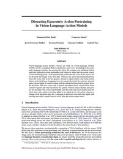</a>
  <a href="https://github.com/JacobFV/vla-action-pretraining">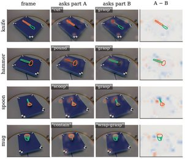</a>
  <a href="https://jvboid.dev/projects/rrp">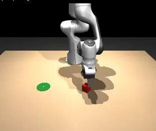</a>
  <a href="https://jvboid.dev/projects/rrp">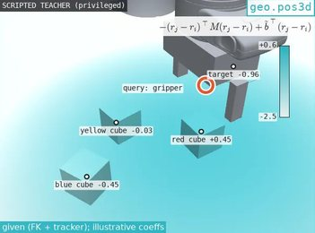</a>
  <a href="https://talos.commandagi.app/#scenes">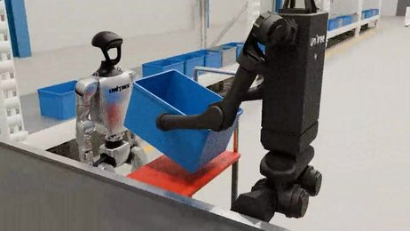</a>
  <a href="https://talos.commandagi.app/#scenes">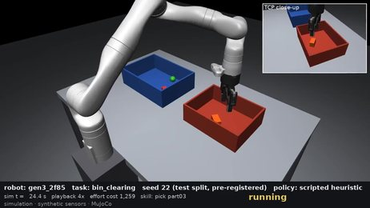</a>
  

  UniReps ’26 paper · instruction attention · Panda rollout · relative positions · warehouse training scenes with Unitree G1 and H1

- **[CommandAGI](https://commandagi.com) ([repo](https://github.com/CommandAGI/commandagi)) — branchable execution environments for agents.** I am building a live agent platform where computer and robot sessions are observable, interruptible, snapshotable, forkable, resumable, and metered. The system couples a Next.js/React PWA to a Hono control plane on Cloudflare Durable Objects, D1, and KV; keyless GCE provisioning; an in-VM Python computer-use runtime; data-driven 3D worlds; BYO-robot registration; Python, TypeScript, and Go SDKs; WebRTC intervention; finite-capacity scheduling; and prepaid settlement.

  

  <a href="https://commandagi.com/for/factory-simulation/#scale">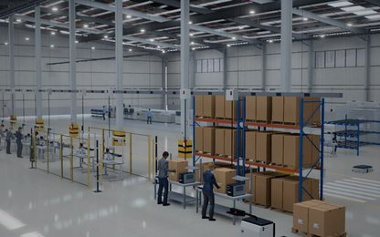</a>
  <a href="https://commandagi.com/for/humanoids/#cnc-tending">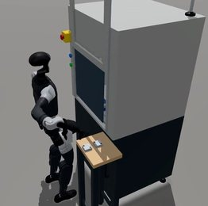</a>
  <a href="https://commandagi.com/app">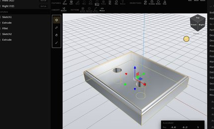</a>
  <a href="https://commandagi.com/explore/make">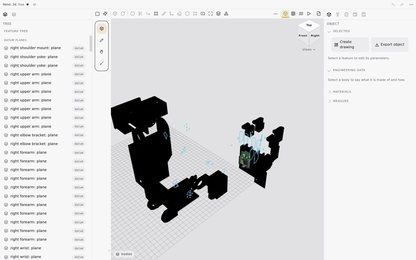</a>
  <a href="https://commandagi.com/for/agent-clis/#backlog">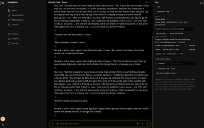</a>
  

  188-unit factory · G1 loads a CNC mill · CAD editor · UpperBody-001 palm PCB · Claude Code and Codex threads

- **[Canvas Engineering](https://github.com/commandAGI/canvas-engineering) ([docs](https://commandagi.github.io/canvas-engineering/), [research article](https://commandagi.com/research/canvas-engineering)) — declared causal macrostructure compiled into diffusion-transformer computation.** A typed schema specifies latent regions, directed connectivity, update clocks, and loss roles; the compiler lowers it into exact attention masks, loss weights, and frame mappings, making absent edges hard conditional independences. The evidence program, [ROAM](https://github.com/JacobFV/recursive-omnimodal-video-action-model) ([dossier](https://jvboid.dev/projects/recursive-omnimodal-video-action-model)), spans 26 experiments and 236 runs: a frozen three-loop CogVideoX-2B graft reached 0.073 action loss with 350K trainable parameters versus 0.088 with 11.7M unfrozen, while three reasoning hypotheses failed. A 23-region/42-path cortical canvas matched a dense model at R² 0.825 vs. 0.826 using 19.6% of the connections and ~5× less training time; it predicts TRIBE encoder outputs, not measured biology.

  

  <a href="https://jvboid.dev/assets/pdf/canvas-engineering-paper.pdf">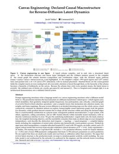</a>
  <a href="https://commandagi.github.io/canvas-engineering/concepts/topology/">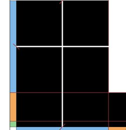</a>
  <a href="https://jvboid.dev/projects/canvas-engineering">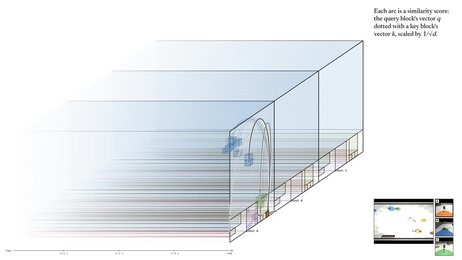</a>
  <a href="https://jvboid.dev/assets/pdf/canvas-engineering-paper.pdf">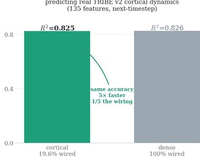</a>
  

  paper · compiled attention mask · three-robot swarm · cortical canvas vs. dense on TRIBE v2

- **[WIN / B-WIN](https://github.com/JacobFV/win) · [SC-WBD](https://github.com/JacobFV/sc-wbd) ([live results](https://sc-wbd.pages.dev), [dossier](https://jvboid.dev/projects/sc-wbd)) — heterogeneous multirate world and brain dynamics.** WIN retains each state variable's native support, frame, clock, units, uncertainty, and update law, connecting fully qualified `(entity, domain, support, channel, clock)` addresses through typed interactions and evidence-permission paths. SC-WBD instantiates the program over 414 regions and 26.3M parameters with declared forward operators and four public checkpoints. Checkpoint 003 improved density score by ~0.04 nats over VAR/AR baselines on 27 held-out participants; 004 did not reproduce it. Leave-one-source-out found 64-channel EEG at +0.0144 and fMRI at +0.0010, while simulator pretraining scored −0.0034 on measured data; all five biological claim gates currently read `could_not_run`, hence zero validated brain claims.

  

  <a href="https://sc-wbd.pages.dev">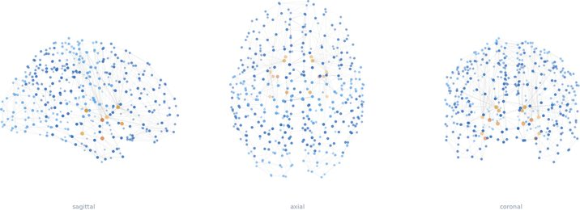</a>
  <a href="https://super-cognition-labs.github.io/IBM-1/#retrieval">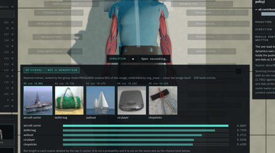</a>
  <a href="https://www.linkedin.com/posts/jacob-f-valdez_grateful-for-the-opportunity-to-share-progress-activity-7502718067592810496-prs0">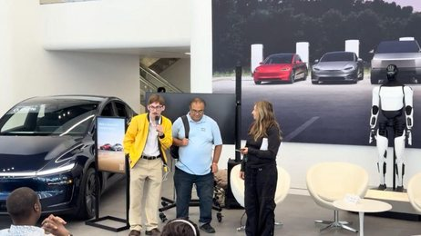</a>
  

  SC-WBD connectome · <a href="https://super-cognition-labs.github.io/IBM-1/">IBM-1</a> ranks the right EEG response first for 127/200 THINGS-EEG2 images (63.5% vs. 0.5% chance) · IBM-1 talk at Tesla

- **[Limboid](https://limboid.ai) ([repo](https://github.com/Limboid/limboid.ai), [BoidKit](https://github.com/Limboid/boidkit), [build archive](https://jvboid.dev/projects/limboid)) — centralized fluid power, distributed low-mass actuation.** One water/glycol pressure source, accumulator, trunks, and zone manifolds drive parallel artificial-muscle bundles through inexpensive proportional valves; deterministic pressure/position/contact loops run at 100–200 Hz below Linux-class estimation and whole-body control. Full-body and upper-body rigs, valve manifolds, printed hand bones, tendon/soft-hand prototypes, CAD, and electronics exist; the centaur is under construction. Per-axis cost, force density, efficiency, and whole-robot BOM remain engineering targets, not measurements.

  

  <a href="https://jvboid.dev/projects/limboid">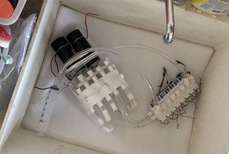</a>
  <a href="https://jvboid.dev/projects/limboid">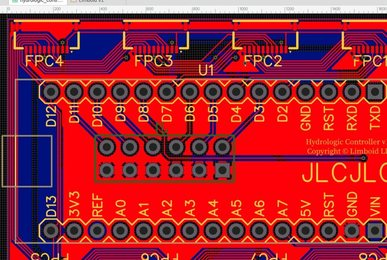</a>
  <a href="https://limboid.ai/technology/#bodies">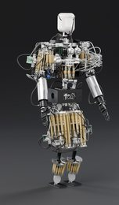</a>
  <a href="https://limboid.ai/technology/#bodies">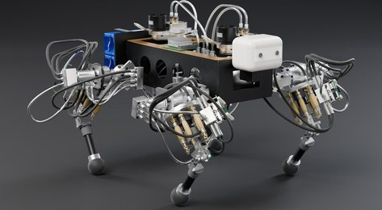</a>
  

  fluidic hands · valve-driver PCB · BoidKit humanoid and quadruped, one hydraulic design across bodies

- **[SynthUX](https://github.com/JacobFV/synthux) ([dataset](https://huggingface.co/datasets/jacob-valdez/synthux-visual-tree-0.1-beta), [dossier](https://jvboid.dev/projects/synthux)) — grounded visual computer-use data without full VMs.** A grammar expands goals into arbitrary-depth task trees whose terminal affordances execute as low-level mouse/keyboard events inside [Windows](https://github.com/JacobFV/windows-web-next), [macOS](https://github.com/JacobFV/macos-web-next), and [browser](https://github.com/JacobFV/browser-os) simulators; screenshots, observed state, videos, generated artifacts, and node-level alignment remain causally connected. The v2 schema/world/resolver/scheduler/validator path has 106 tests and demonstrations with up to four actors, three environments, and cross-stream channel handoffs; v1 still generates the current public dataset.

  
<a href="https://jvboid.dev/projects/synthux">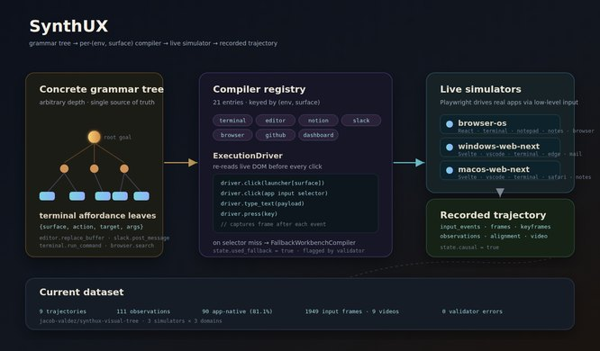</a>

- **[Chem-0](https://github.com/JacobFV/chem-0) ([technical essay](https://jvboid.dev/posts/chem-0-hidden-labor-of-reality-contact), [follow-on](https://github.com/JacobFV/phys-0)) — inspectable low-cost robot control.** An LLM operates a LeRobot SO-101/SO-100 through one typed tool surface shared by Electron and MCP. TypeScript owns sessions, SQLite events, artifacts, and model streaming; a JSON-lines bridge reaches Python/OpenCV/LeRobot, where calibrated joint/workspace bounds, step interpolation, URDF kinematics, and `placo` FK/IK gate commands before the Feetech bus.

- **[EEG Acquisition Chain](https://github.com/JacobFV/eeg-acquisition-chain) — cortical current dipoles to multiplexed ADC input.** The deterministic interactive model spans volume conduction, CSF/skull/scalp spatial mixing, contact mechanics, CPE electrode impedance, AFE common-mode leakage, gain/filtering, and AMUX sampling. It separately exposes attenuation, irrecoverable spatial mixing, Johnson/amplifier/quantization noise, impedance imbalance, settling, charge injection, crosstalk, skew, and real alias folding, with every parameter marked by provenance and observability.

  
<a href="https://github.com/JacobFV/eeg-acquisition-chain">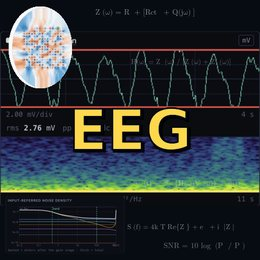</a>

- **[Exocortex](https://exocortex2.com) ([specs](https://exocortex2.com/specs), [dossier](https://jvboid.dev/projects/exocortex)) — a dry EEG cap built for density, with CommandAGI and [Helm Technologies](https://www.visithelm.com) (June 2026–present).** The cap targets 1,118 dry contacts sampled at 500 Hz per channel, laid out on 66 tiles that route to an acquisition hub through 16 daisy chains; five brim cameras record the wearer's view. The software side covers EEG calibration, a mobile timeline, and a desktop lifetime view.

  

  <a href="https://exocortex2.com">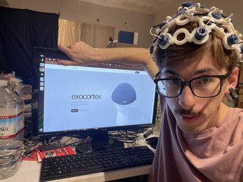</a>
  <a href="https://exocortex2.com">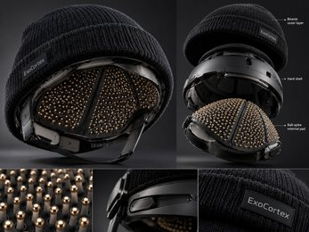</a>
  <a href="https://exocortex2.com/specs">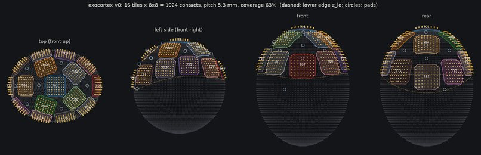</a>
  <a href="https://exocortex2.com/specs">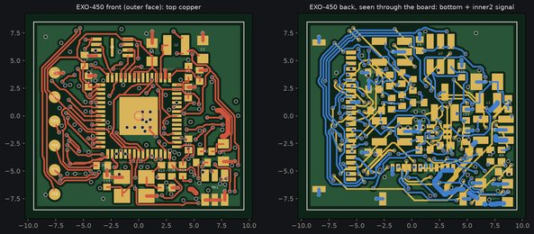</a>
  

  wearing the headset · cap concept · electrode layout · tile copper layers

- **[ComputerWorld](https://computaco.ai/computerworld/) ([Rust engine](https://github.com/ComputaCo/computerworld-engine), [fork benchmark](https://computaco.ai/studies/forking), [replay](https://computaco.ai/docs/determinism)) — forkable simulated companies for agent training ([ComputaCo](https://computaco.ai), open-core October 2026).** The engine runs five OS shells on one simulated network: fork a company before a decision, change one input, and replay both branches. Branches share immutable 256-event log blocks and copy only the open tail, so the median fork costs 35 µs after 1,000 actor steps on one pinned ARM core; with 16,013 events already logged, step time fell from 176.2 ms to 219.2 µs with identical replay hashes. On top, a FreeCAD feature tree compiles into 86 mouse and keyboard actions that rebuild the solid and check 16 geometric requirements ([260 verified expert episodes](https://computaco.ai/expert/)); whole companies run on the network — four Halyard engineers checking tolerances and scheduling a pilot build, a Northstar launch with 21 simulated employees and buyers — and Computatrum previews its clicks and asks approval before paying.

  

  <a href="https://computaco.ai/#society">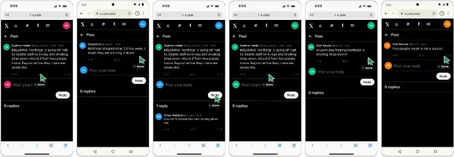</a>
  <a href="https://computaco.ai/expert/#example">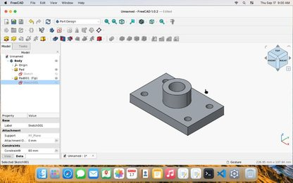</a>
  <a href="https://computaco.ai/#arrange">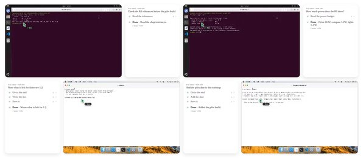</a>
  <a href="https://computaco.ai/computerworld/">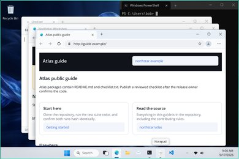</a>
  

  six networked phones · FreeCAD replay · Halyard engineering · a simulated Windows desktop

- **[The Tensor Computer](https://jvboid.dev/projects/tensor-computer) ([paper](https://jvboid.dev/assets/pdf/tensor-computer-paper.pdf), [post](https://x.com/jvboid/status/2116677680976539917)) — machine code made differentiable (February 2026).** A complete von Neumann machine — ALU, registers, cache, memory, disk, GPU — rebuilt as JAX tensor operations. The ALU runs all 32 operations every cycle and mixes their outputs by opcode weight; lowering the softmax temperature toward zero recovers discrete execution, so the same program is both an executable and a point in a loss landscape. C, Rust, C++, and JAX implementations agree on 59 conformance vectors, and a self-hosting C compiler on the machine matches the host's output byte for byte.

  

  <a href="https://jvboid.dev/assets/pdf/tensor-computer-paper.pdf">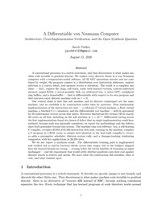</a>
  <a href="https://jvboid.dev/assets/pdf/tensor-computer-paper.pdf#page=6">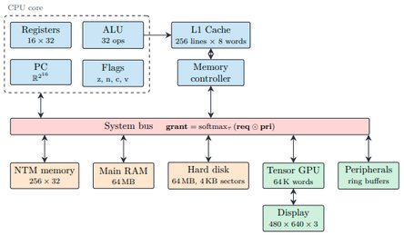</a>
  <a href="https://jvboid.dev/assets/pdf/tensor-computer-paper.pdf#page=9">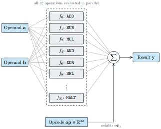</a>
  <a href="https://jvboid.dev/assets/media/tensor-computer/agent-comparison.webm#t=5">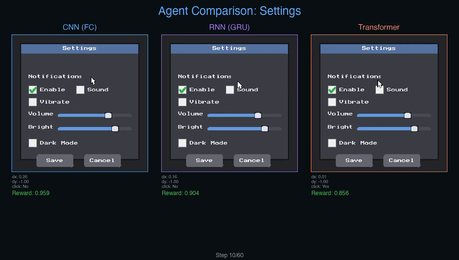</a>
  

  paper · machine architecture · opcode mixture · three agents on one Settings task

- **[LabRat](https://github.com/JacobFV/labrat) and Tappet — desktop lab robotics in a day (October 2026).** LabRat, 2nd place at [Cerebral Valley's MongoDB hackathon](https://cerebralvalley.ai/e/mongodb-sftw-hackathon/hackathon/gallery/58), is a robotic lab built in one day: two SO-101 arms capture 30 Hz demonstrations, a servo pipette on a 3018 CNC transfers liquid, 16 protocols are screened in simulation for motion, volume, and tip use, and an iPhone reads the bench result back so calibration updates that reduce prediction error are retained. [Tappet](https://github.com/JacobFV/labrat/tree/main/tappet) taps a phone with two 3-joint arms and capacitive styli, calibrating the screen mapping from nine points; across 100 simulated taps with servo noise and backlash the mean error is 0.81 mm (95th percentile 1.70 mm), with open CAD, schematic, firmware, and calibration procedure.

  

  <a href="https://cerebralvalley.ai/e/mongodb-sftw-hackathon/hackathon/gallery/58">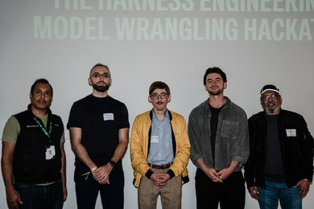</a>
  <a href="https://jvboid.dev/projects/labrat">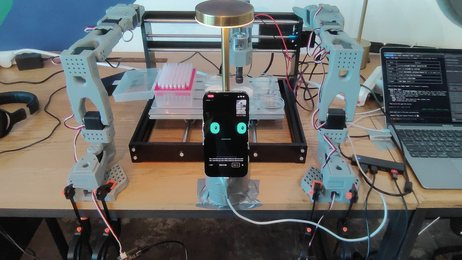</a>
  <a href="https://github.com/JacobFV/labrat/blob/main/apps/console/twin.js">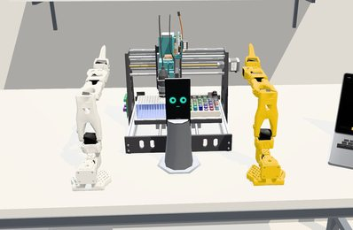</a>
  <a href="https://github.com/JacobFV/tappet#kinematics-and-precision">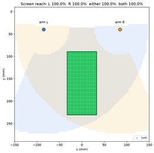</a>
  <a href="https://github.com/JacobFV/tappet/blob/main/hardware/electronics/drawings/schematic_logic.svg">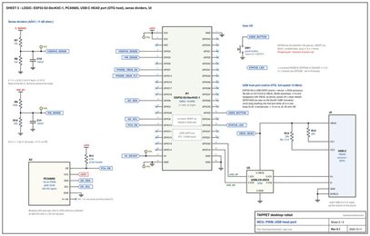</a>
  

  MongoDB hackathon, 2nd place · demonstration bench · digital twin · Tappet screen reach · control electronics

- **[Lunar Rover](https://jvboid.dev/projects/lunar-rover) — distributed robot control at YC RoboHacks (April 2026).** A four-person team built a regolith-sampling rover in a weekend, with parts printed onsite. Control runs across four nodes — a remote viewer, ground control, a simulated satellite relay, and the onboard computer — and route planning was demonstrated on the hardware, not only in simulation.

  

  <a href="https://x.com/jvboid/status/2045663881914388515">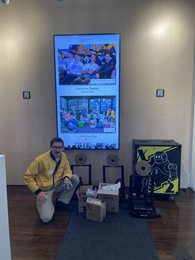</a>
  <a href="https://x.com/jvboid/status/2045663881914388515">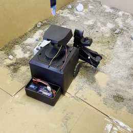</a>
  

- **[Earlier systems](https://jvboid.dev/projects) — mechanisms, not stack badges.**
  - **[BSBR](https://github.com/JacobFV/bsbr) (March 2025) — near-linear long-context attention.** Block Sparse attention with Block Retrieval keeps ordinary attention exact inside fixed-size chunks and adds a meta-attention that retrieves between chunks from one compressed state vector per chunk, so the between-chunk term grows with n/B instead of n. It ships as a pip-installable PyTorch module with a GPT-2 converter and was benchmarked against six other architectures: 5.6× faster than linear attention and 30× faster than DeltaNet at 1,024 tokens.
  - **[TensorCode](https://github.com/TensaCo/tensacode) ([dossier](https://jvboid.dev/projects/tensacode), [PyPI](https://pypi.org/project/tensorcode/), [npm](https://www.npmjs.com/package/tensorcode); 2022, revived 2026) — written code and trained models in one program.** A neurosymbolic framework for Python and TypeScript that traces any value through ordinary code, lets you supervise it wherever it appears, and fits only the learned steps on its path, so the line between hand-written logic and a trained component can be moved without rewriting glue. It reaches 89.4% on banking77 (77 intents) after 3.3 s of CPU training.
  - **[MPNets](https://github.com/Limboid/mpnets) ([dossier](https://jvboid.dev/projects/multiparadigm-networks); 2022) — many learning rules, one executable graph.** One policy is trained at once under supervised, self-supervised, unsupervised, reinforcement, Hebbian, feedback, and structural learning signals, on one graph-based architecture with its own executor.
  - **[Node Tree](https://github.com/Limboid/node-tree) ([dossier](https://jvboid.dev/projects/node-tree); 2022) — paired language and demonstrations from one grammar.** Typed grammar nodes generate tree-shaped processes that render a natural-language description and execute the matching demonstration in an environment, producing description–demonstration pairs by construction instead of by annotation.
  - **[jnumpy](https://github.com/JacobFV/jnumpy) (2021) — a deep-learning library written to be allowed to use one.** UT Arlington ML courses banned third-party frameworks but allowed your own code, so I wrote arbitrary-DAG autodiff with neural-network and RL abstractions on numpy; it carried three courses and later grew connect-4 reinforcement learning and a C port.
  - **[DesparadosAEye](https://github.com/kmosoti/DesparadosAEYE) (2021) — a 335M-parameter chatbot with no server.** I led a five-person team porting Facebook's BlenderBot-small to TensorFlow Lite so it runs fully on-device on Android, with Kotlin/Java and SQLite around it; presented at UTA Innovation Day 2021.
  - **[MLN-Dashboard](https://github.com/JacobFV/mln-dashboard) ([dossier](https://jvboid.dev/projects/mln-dashboard); 2021–2022) — a modular research-visualization server.** Built and architected as a research assistant at UTA's IT Lab for multilayer networks: a TypeScript, React/Next.js, and GraphQL stack with Prisma and Strapi.
  - **Hardware without vendor software.** The [ESP32-S3 USB webcam](https://github.com/JacobFV/esp32-usb-webcam) is ESP-IDF firmware that makes a XIAO ESP32S3 Sense enumerate as a USB Video Class device streaming MJPEG — Linux sees a normal `/dev/video0` and OpenCV captured 640×480 frames with no custom driver. The [microscope viewer](https://github.com/JacobFV/microscope-viewer) streams a non-UVC USB microscope by driving its vendor-specific supercamera protocol over a small Python USB bridge, since the device never exposes a video node at all. Alongside them: CNC machines, actuators, and embedded control.

  

  <a href="https://github.com/JacobFV/bsbr">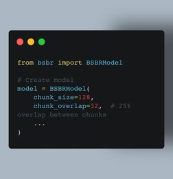</a>
  <a href="https://jvboid.dev/projects/tensacode">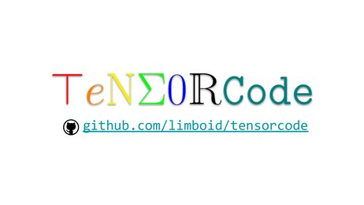</a>
  <a href="https://jvboid.dev/projects/multiparadigm-networks">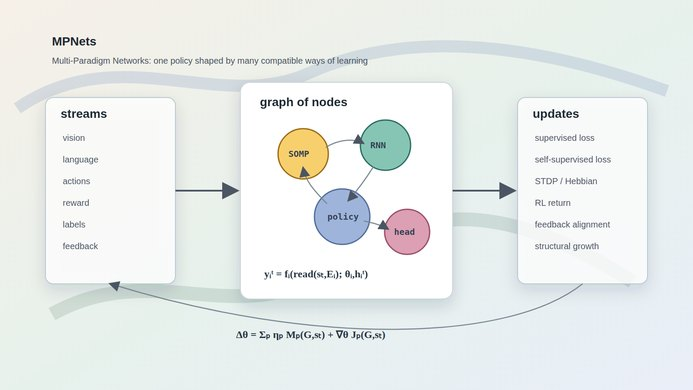</a>
  <a href="https://jvboid.dev/projects/node-tree">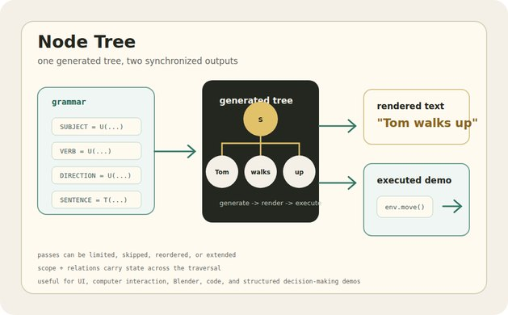</a>
  
  <a href="https://jvboid.dev/projects/esp32-usb-webcam">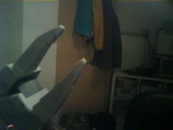</a>
  <a href="https://jvboid.dev/projects/microscope-viewer">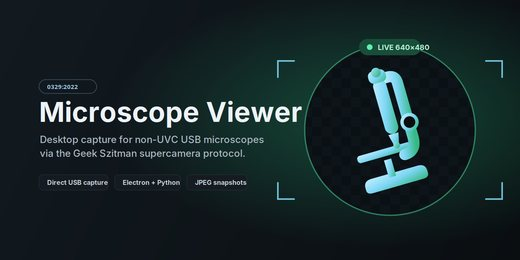</a>
  

  BSBR · TensorCode · MPNets · Node Tree · MLN-Dashboard · ESP32-S3 webcam frame · microscope viewer

- **[Production systems](https://jvboid.dev/resume).** At AGI, Inc. I worked across the agent runtime, mobile integration, and eval tooling, then owned API/SDK/partner surfaces spanning iOS, on-device LLMs, quantization, schemas, and the agent control plane. Earlier I was founding engineer / software engineer #2 at Breezy AI, working across a Rails/Next.js AI-receptionist monorepo.
